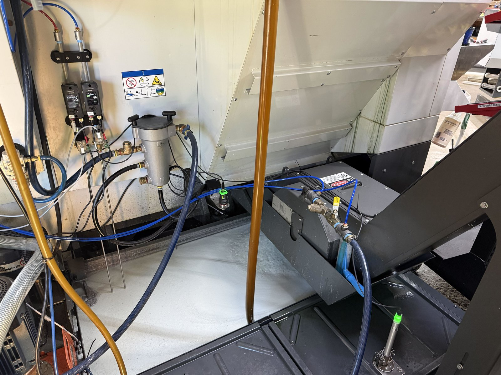
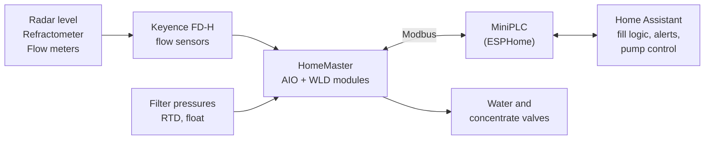
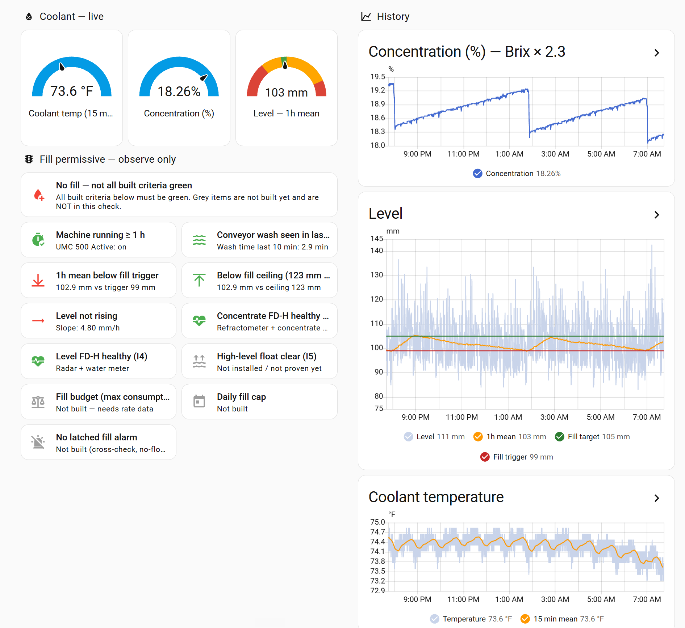

# CNC coolant auto-fill

How we built automatic coolant monitoring and water auto-fill on a Haas
UMC-500 at [Revolute Machine](https://revolutemachine.com), a CNC shop in Coal
Valley, Illinois — with the sensors, wiring, control logic, safety reasoning
and the data, including what didn't work.

People saw it on social media and asked how it was done. This is the answer, in
one place.

> ## ⚠️ Read this first
>
> **This is one way we did it on our machine. It is a work in progress, not a
> product.**
>
> It controls valves that put water and coolant into a running machine. **You
> are responsible for your own design, electrical safety and code compliance.**
> Some components (the HomeMaster modules) are CE-marked but **not UL listed or
> FCC certified**.
>
> **No warranty.** See [LICENSE](LICENSE) and [LICENSE-docs](LICENSE-docs).



*Flow meters and valves on the left wall, the radar just right of the filter, the
refractometer in the tank at bottom right.*

## What it does



- **Watches** tank level (radar), coolant concentration (refractometer),
  coolant temperature, filter pressures, and whether the machine is running.
- **Tops up water automatically** — small metered fills of ~3 gal, a few times
  a day, only when the level reading can be trusted.
- **Alerts** a phone on overflow risk, low level, a stuck valve or a blocked
  fill.
- **Concentrate dosing** is designed but **not automated yet** — it's watched
  on a dashboard and done by hand for now.



*Our dashboard from the observe-only days (setpoints were 99/105 mm then). Each
fill criterion has its own tile; the level graph shows the raw sawtooth (light
blue) and the 1-hour mean the logic actually uses (orange). The concentration
graph shows each overnight fill as a step down.*

## Results so far

- Automatic water fills **running unattended since 2026-10-16**, including
  weekends, on one Haas UMC-500. Fills of ~3 min each; the valve watchdog has
  never tripped.
- Measured: consumption **≈ 0.7–0.9 gal/h** while running, drain-back of
  6–25 mm on stop, concentrate carry-out **≈ 1 gal/day**, and chip-barrel
  returns adding 5–7 gal/day on busy runs.
- The worst case we designed for — a fill, then the machine stopping half an
  hour later — happened for real and stayed ~72 mm below the tank lip.

More in [docs/results.md](docs/results.md).

## Status

| Part | Status |
|---|---|
| Filter pressure monitoring | ✅ In production |
| Level, Brix and temperature monitoring | ✅ Running |
| Automatic water fills | ✅ Running unattended, with known gaps ([safety.md](docs/safety.md#known-gaps-as-of-2026-10-23)) |
| High-level float | 🟡 Wired and proven; not mounted, not yet in the fill logic |
| Concentrate dosing | 🟡 Designed, observe-only; doses by hand |
| Moving the fill logic from Home Assistant into ESPHome | ⏳ Planned |
| Second machine | ⏳ Planned |

## Cost

**About $4,000 per machine in parts**, of which **about $2,000 is the Keyence
sensors** (two clamp-on flow meters, refractometer, radar). The filter-pressure
monitoring is about $600 of the rest. Details in [docs/bom.md](docs/bom.md).

## Where to start

1. **[docs/fill-logic.md](docs/fill-logic.md)** — the fill criteria and *why*
   each one exists. If you read one page, read this one.
2. **[docs/safety.md](docs/safety.md)** — what can go wrong, what catches it,
   and what's still open.
3. **[docs/architecture.md](docs/architecture.md)** — how the pieces connect.
4. Then [bom.md](docs/bom.md), [wiring.md](docs/wiring.md) and
   [build-notes.md](docs/build-notes.md) if you're building one.
5. [lessons.md](docs/lessons.md) before you buy anything.

## Repository map

```
README.md                    this page
docs/
  architecture.md            sensors → FD-H → HomeMaster → ESPHome → Home Assistant
  fill-logic.md              ⭐ the fill criteria and why
  safety.md                  failure modes, mitigations, known gaps
  bom.md, bom.csv            parts, part numbers, suppliers, prices (dated)
  wiring.md                  power, fusing, shunt blocks, grounding, valves
  build-notes.md             mounting rules, sensor settings, commissioning tests
  lessons.md                 things that bit us
  results.md                 what the data showed
config/
  esphome/                   MiniPLC config, including the valve watchdog
  home-assistant/            fill script, permissive, automations, helpers
images/
  drawings/                  pin-level wiring (SVG, draw.io) and its netlist source
  photos/                    the panel
```

## Licences

- **Code and configuration** (`config/`, `images/drawings/netlist.py`): [MIT](LICENSE).
- **Documentation, drawings and photos**: [CC BY 4.0](LICENSE-docs).

Questions, corrections and "we did it differently" are welcome — open an issue.
