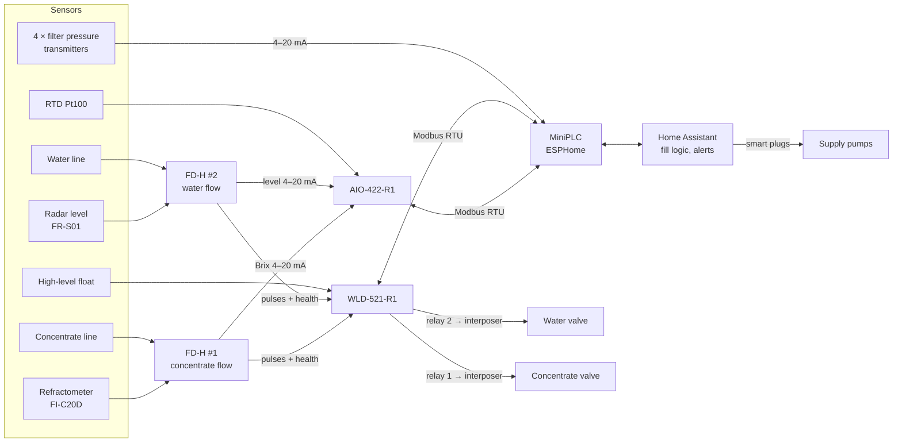
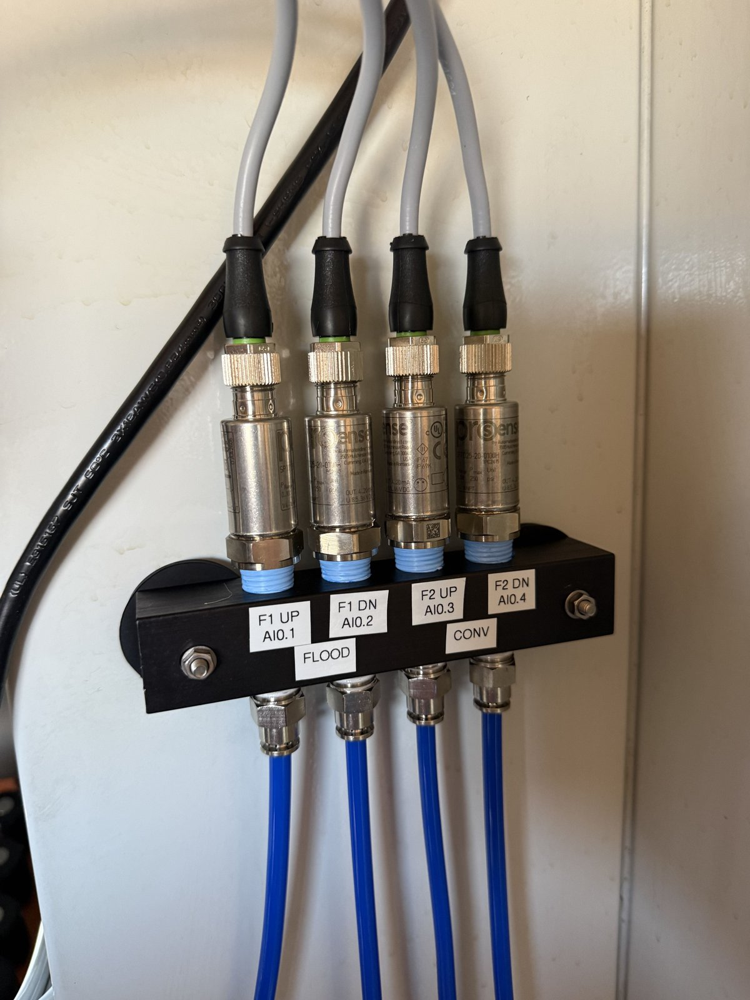
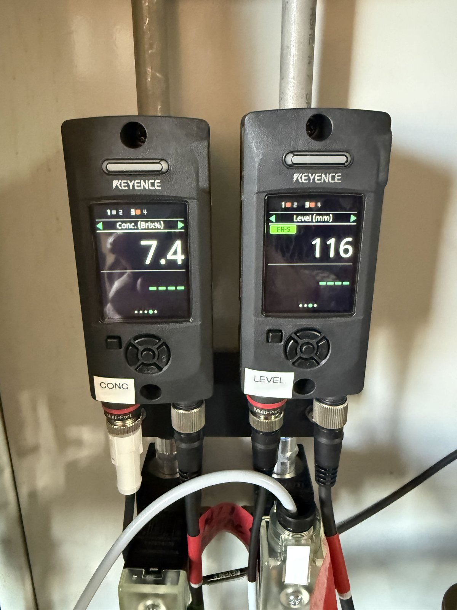

# Architecture

How a level reading gets from the tank to a decision, and where each piece of
logic lives.

## Signal chain overview

## Sensors

| Measures | Sensor | Into |
|---|---|---|
| Tank level | Keyence **FR-S01** short-range radar | FD-H #2 Multi-port → 4–20 mA |
| Concentration (Brix) | Keyence **FI-C20D** probe refractometer | FD-H #1 Multi-port → 4–20 mA |
| Water and concentrate flow | Keyence **FD-H10** clamp-on ultrasonic, one per line | Pulse output → WLD counters |
| Coolant temperature | ProSense **RTD1** Pt100 | AIO RTD input |
| High level (backstop) | AutomationDirect **FLS-VL-600** float | WLD I5 |
| Filter health | 4 × ProSense **SPTD25-20-0100H** pressure transmitters (up/downstream of 2 filters) | MiniPLC analog inputs |
| Machine running | Shelly Pro 3EM current on one phase | Home Assistant |

The filter-pressure monitoring isn't needed for auto-fill, but it shares the
cabinet and turned out to be essential: the **conveyor filter's upstream
pressure is how we know the conveyor wash is running**, which is one of the
fill criteria.

*The four filter-pressure transmitters on a common manifold, fed by tubing from
taps at each filter. F1 = flood coolant filter, F2 = conveyor wash filter.*

## Keyence FD-H as the sensor hub

The refractometer has **no outputs of its own** — it has to plug into the
Multi-port of an FD-H flow sensor (or Keyence's separate display unit), which
powers it and reports Brix on its own analog output. We found the radar can go
on an FD-H Multi-port too (through the OP-88444 8-to-4-pin adapter cable; the
FD-H recognises it). So each flow meter doubles as the display head for one
other sensor:

- **FD-H #1** = concentrate flow + refractometer
- **FD-H #2** = water flow + radar

*Each flow meter's display shows its Multi-port sensor: Brix on the left unit,
level on the right.*

Each FD-H then gives us, on its one M12 cable:
- **Ch1** — flow pulses (0.02 L/pulse, NPN) → WLD counter
- **Ch2** — Brix or level as 4–20 mA → shunt → AIO analog input
- **Ch3** — "Error" output (health) → WLD input
- Ch4 — unused

This saved a separate display unit for the refractometer and a standalone
power/signal cable for the radar, and it kept the radar's analog loop on the
FD-H (which tolerates a 500 Ω load) rather than on the radar itself (260 Ω max).

## HomeMaster modules and Modbus

The controller is a HomeMaster **MiniPLC** (ESP32, DIN rail, ESPHome) with two
HomeMaster expansion modules on RS-485 Modbus RTU at 19,200 baud:

| Module | Address | Firmware | Job here |
|---|---|---|---|
| **AIO-422-R1** | 3 | v0.2.0 | 4 × 0–10 V analog in (Brix, level, 2 spare), RTD input |
| **WLD-521-R1** | 4 | v0.1.0 | 5 inputs (2 pulse counters, 2 health, float), 2 relays (valves) |

Things worth knowing up front (details in [lessons.md](lessons.md)):

- **Read each module's address from its own config tool.** The documented
  defaults were wrong for every module we bought.
- **The ESPHome package you import must match the firmware actually on that
  module**, not what the README says. Register maps differ between versions.
- **Module firmware is a fixed menu, not a programmable controller.** Custom
  logic on a module would mean forking the vendor's firmware and flashing every
  module by USB. We put all logic on the MiniPLC instead and treat the modules
  as smart I/O.
- The WLD module has **no** volume-target/"irrigation" logic and **no**
  comm-loss failsafe, despite what its README describes.

The analog inputs on both the MiniPLC and the AIO are **voltage only** (0–10 V).
Every 4–20 mA signal goes through a 499 Ω shunt resistor at the terminal
blocks — see [wiring.md](wiring.md#analog-inputs-and-the-shunt-blocks).

## ESPHome on the MiniPLC

The MiniPLC's ESPHome config ([`config/esphome/`](../config/esphome/)) does:

- Modbus master for the AIO and WLD (vendor packages).
- Filter pressures: per-channel calibration, ΔP per filter, and a 2-minute
  average gated on that filter's pump running.
- **Valve watchdog** — forces the water valve off after 6 min and the
  concentrate valve after 3 min, re-sending "off" every 5 s until the WLD
  confirms. Latches a *Valve watchdog tripped* flag. Works with Home Assistant
  down.
- **Both valves off on boot.**

It's on wired Ethernet, not Wi-Fi.

## Home Assistant's role

Home Assistant ([`config/home-assistant/`](../config/home-assistant/)) does
today:

- Scaling of Brix and level from millivolts, with "unknown" outside
  3.8–20.5 mA so a broken loop never reads as zero.
- The derived signals: 1 h mean, 5-min mean, rising trend, slope, conveyor-wash
  detection, run state.
- **The fill permissive, the automatic fill and the metered fill script.**
- Alerts to a phone (critical alerts break through Do Not Disturb).
- Supply pump control (staffed hours, 30-min after-hours limit).
- Dashboards.

## Where each piece of logic lives, and why

| Logic | Lives in | Why |
|---|---|---|
| Valve watchdog, close on boot | ESPHome on the MiniPLC | Must work with Home Assistant down |
| Filter pressure conversion and gating | ESPHome | Survives if Home Assistant goes away |
| Fill permissive, metered fill | **Home Assistant (today)** | Fastest to iterate while learning. **Planned to move into ESPHome** so the fill doesn't depend on Home Assistant |
| Level/Brix scaling | Home Assistant (today) | Started as bench scaffolding; planned to move into ESPHome with the fill logic |
| Alerts, pump schedules, dashboards | Home Assistant | That's what it's for |
| Pulse counting | WLD module | Counts locally, so a missed Modbus poll loses nothing |

**Fail-safe direction everywhere:** normally-closed valves, valves closed on
boot, pumps off outside staffed hours, broken loops read "unknown" (never
zero), a blind radar reads "full".

## I/O map

Each FD-H "owns" its numbers: odd for #1, even for #2. So **every "1" is
concentrate and every "2" is water** end to end — relay, FD-H, pulse input,
health input — except the two AIO analog inputs, which are Brix (AI1) and
level (AI2).

| Signal | FD-H #1 (refractometer + concentrate) | FD-H #2 (radar + water) |
|---|---|---|
| Ch2 white, 4–20 mA → AIO | **AI1** — Brix | **AI2** — level |
| Ch1 black, pulses → WLD | **I1** — concentrate flow | **I2** — water flow |
| Ch3 grey, Error → WLD | **I3** — refractometer FD-H health | **I4** — level FD-H health |
| Valve relay | **WLD relay 1** — concentrate valve | **WLD relay 2** — water valve |

| Other | Where |
|---|---|
| High-level float | WLD **I5** (switched isolated 5 V) |
| Coolant temperature | AIO **RTD1** |
| Filter pressures | MiniPLC **AI1–AI4** = flood filter up, flood down, conveyor filter up, conveyor down |
| Spare 4–20 mA inputs | AIO AI3, AI4 (shunts fitted, bulkheads capped) |

⚠️ The AIO lists its analog inputs right-to-left on the module (AI4 AI3 AI2
AI1). After any rewiring, check Brix still reads on AI1 and level on AI2.
