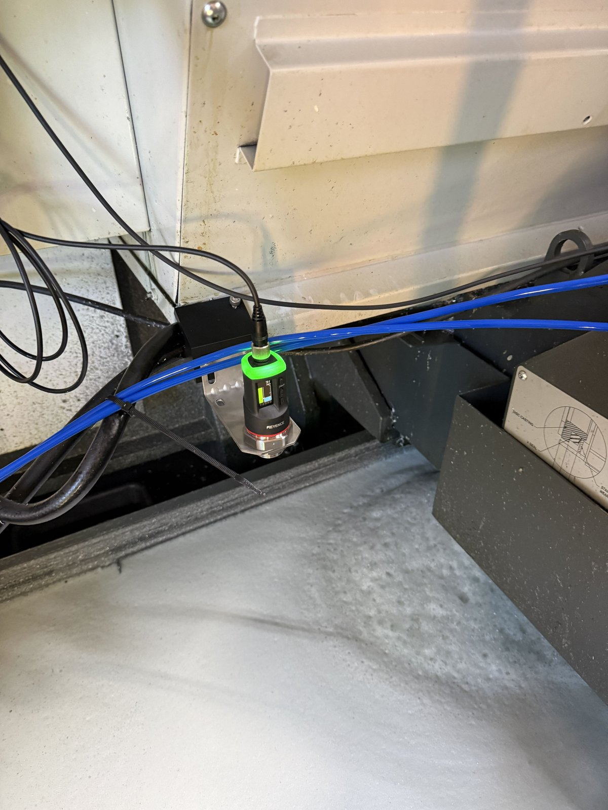
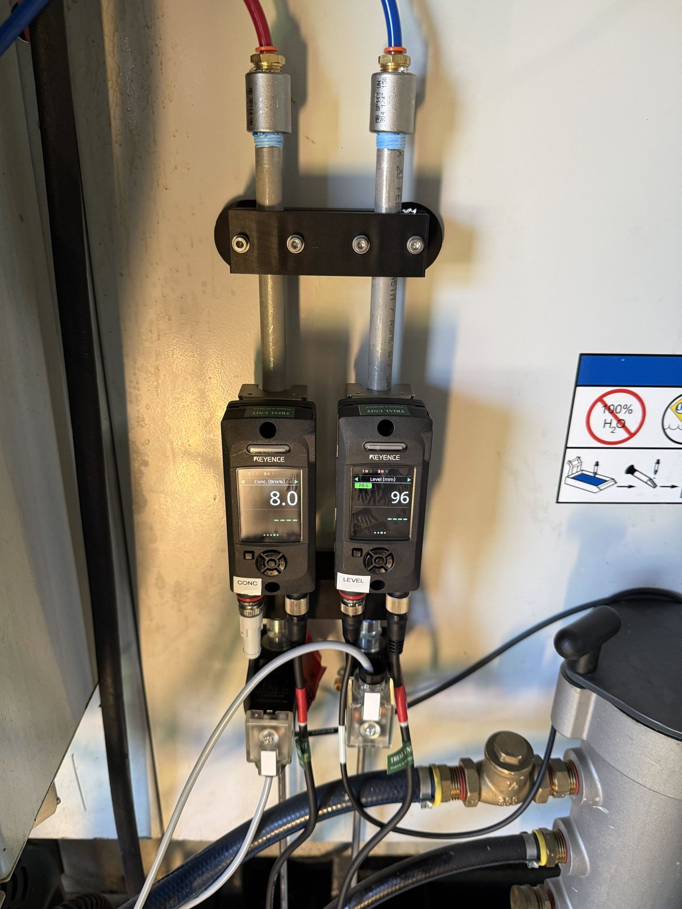
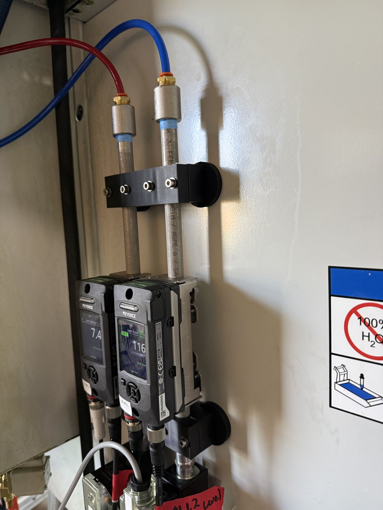
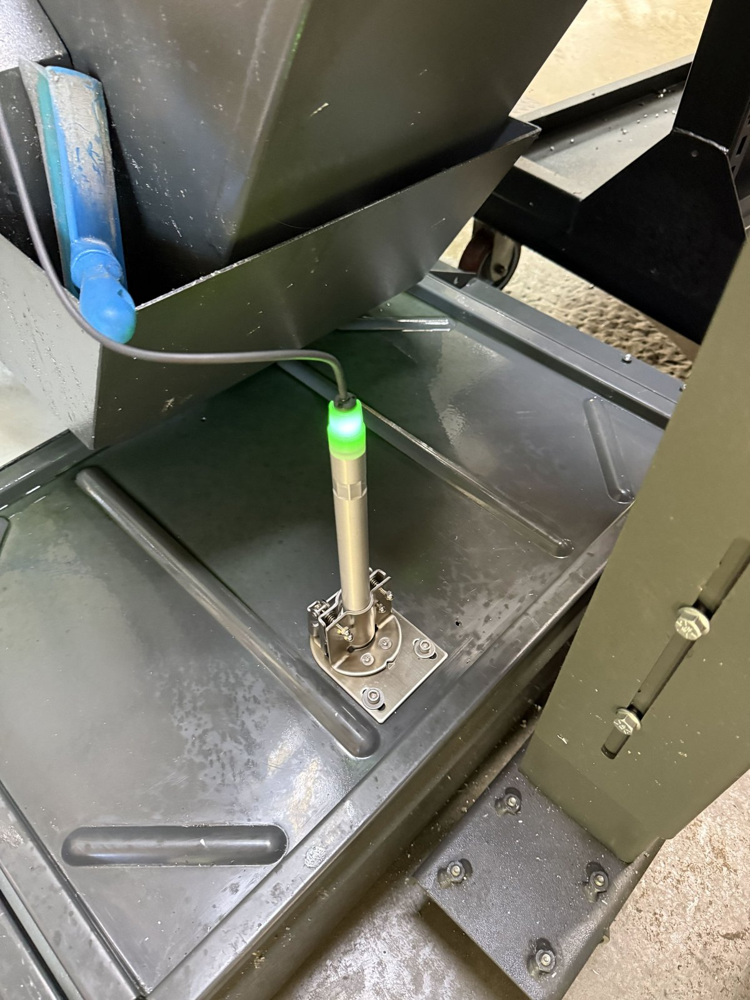

# Build notes

Mounting rules, the exact settings we used, and the commissioning tests we ran.
Brackets and plumbing are different on every machine, so this page gives the
rules rather than parts.

## Radar mounting

The Keyence FR-S01's accuracy depends on distance to the surface:

| Distance to surface | Accuracy |
|---|---|
| 0.3–1.5 m (12–59 in) | ±1 mm |
| 0.1–0.3 m (4–12 in) | ±5 mm |
| < 0.1 m (4 in) | ±20 mm |

- **Mount the sensor face ≥ 300 mm (12 in) above the highest level coolant can
  reach** — the tank lip, not the running level. 350–450 mm (14–18 in) is a
  good target; higher gains nothing. Ours sits about 400 mm above the surface.
- **Keep the beam clear.** On water-based liquid the detecting area is narrow
  (≈ ø80 mm at 0.5 m, ø130 mm at 1 m), but keep metal out of that cone, mount
  square to the surface, and **stay away from where returning coolant splashes
  in** — that's the likely cause of our raw spikes.
- **Rigid, anti-rotation mount, bolted to structure, checked plumb.** Tilt alone
  barely matters (5° at 350 mm ≈ 1.3 mm), but the beam half-angle is only ~4–5°,
  so a real knock swings it off the surface. The result is either no detection
  (reads "full" — safe) or **a bounce off a wall or pipe that reads long, so
  low, so fill — dangerous**. This is why radar health matters
  ([fill-logic.md](fill-logic.md#36-sensor-health-inputs--and-the-fail-safe-gap-we-found)).

*Our radar on Keyence's side bracket, looking straight down at the tank.*

- **Open tanks:** Keyence's side bracket (OP-88873). **Enclosed tanks with a lid
  port:** our plan for the next machines is a ~10 in standoff of 4" PVC over the
  port with a 3D-printed (PETG/ASA) flange and cap, radar on top. We'll
  bench-test the tube's effect on the reading before trusting it.

## RTD mounting

We learned this one from the data: our probe was first hung loosely, and the
temperature swung 68–73 °F in step with the level — the tip was coming out of
the coolant at each running drawdown and reading wet, cooled air.

- **Tip ≈ 50 mm (2 in) above the tank bottom** (45–55 mm window): at least
  30 mm under the lowest running trough (the probe maker's minimum immersion),
  and clear of sludge.
- **Immerse 60–90 mm** of the sheath (10–15 × its diameter) to avoid
  conduction errors from the stem.
- Use the **150 mm** probe (RTD1-25N-150-H) so the head sits above the lip. Our
  first build has the 100 mm version.
- The RTD and the float share a ¼" NPT thread, so one bracket fitting size.

## Float mounting

- Vertical top-mount **FLS-VL-600**: 316 stainless, 2.05" float, ¼" MNPT, reed
  switch. We picked the large float deliberately — it has to sit untouched for
  years and then break free of sludge, so buoyancy matters more than ratings.
- **Trip height:** above the *stopped* (drain-back) level, below the lip. We'll
  set ours relative to 153 mm "full" and the 197 mm lip.
- **Keep it out of the return stream** — the same splash that spikes the radar
  could bounce the float.
- **Exercise it:** periodic lift test, and a reminder if it hasn't changed state
  in 30 days.
- Wiring: see [wiring.md](wiring.md#wld-inputs-they-need-voltage-applied) —
  it switches the WLD's isolated 5 V into I5.
- **Not mounted on our tank yet.** The plan is an adjustable 3D-printed
  (PETG/ASA) bracket for the float and RTD that hooks over the tank lip.
  *Placeholder: bracket files to be added once designed.*

## Flow sensors and the measurement nipple

The FD-H10 clamps onto **rigid pipe**, not tubing (¼" range: ø13–16 mm OD). We
put a short section of **¼" NPT Schedule 40, 304/304L stainless, seamless
nipple** (12 in long, threaded both ends) in each line.

- **Stainless, not brass.** Coolant is alkaline with amines, which attack
  yellow metals — worst on the neat concentrate line. Brass isn't on Keyence's
  list of pipe materials either.
- **Seamless.** A weld seam is a discontinuity the ultrasonic path doesn't
  want. If you must use welded pipe, clock the seam 90° from the transducers.
- **Not soft tubing or PEX** — the standard FD-H is for metal and hard plastic.
- **Valve downstream of the meter**, so the measured section stays full and
  pressurised between fills, and the meter sees flow through a stuck valve.
- **Straight pipe upstream:** Keyence's general guidance is ≥ 5 bore diameters
  (under 2 in for this bore).
- **Orientation:** Keyence's preferred orientations are vertical with flow
  upward, or horizontal with the display standing vertical; a display lying
  flat risks trapped bubbles. **Ours run vertical with flow downward**, which
  Keyence marks "caution" rather than prohibited (bubbles can hang in a slow
  downward flow). It works for us because the valve right below each meter
  keeps the pipe full and pressurised; the FD-H's stability indicator would show
  it if it didn't.

*Concentrate (left) and water (right): supply tubing in at the top, stainless
measurement nipples, the FD-H10s, then the valves. The pipe clamp is
3D-printed.*

- **Keep the sensors powered continuously.** Outputs are invalid for ~15 s
  after power-on and Keyence recommends 15–30 min warm-up.
- **Prime the concentrate line.** Air in it made the meter read **2.1× high**.

## Refractometer

- Keyence **FI-C20D** probe, in the tank on its **FI-CDB1** bracket. Set the
  height so the window is always in liquid; it may only be submerged up to the
  metal at the bottom of its status light.
- Out of the box it read **identical to our handheld** (4.2 Brix) on a
  carefully mixed 10% batch. We leave its span at 1.000 and do the
  Brix → % conversion in software, so it stays directly comparable to the
  handheld.
- Clean the window with dish soap. Pulling it for cleaning reads 0 Brix — our
  concentration sensor ignores anything below 2.0 Brix so that can't look like
  lean coolant.

## FD-H settings (copy for the next machine)

As configured on both units, 2026-10-14:

| Setting | Value |
|---|---|
| Pipe size | ¼" (8A), Metal |
| Additional settings → Pipe O.D. | 13.72 mm |
| Additional settings → Thickness | 2.24 mm |
| Additional settings → **Pipe sound velocity** | **3120 m/s** (stainless; the default 3240 is carbon steel) |
| Detection mode | Hybrid |
| Kinematic viscosity | 0.89 cSt (default) |
| Resolution (accumulated) | 0.01 L |
| **Ch1** | Output → Flow → **Pulse output**, N.O., **0.02 L/pulse** |
| **Ch2** | **Analog**, 4–20 mA — target Conc. (FD-H #1) or Level (FD-H #2) |
| **Ch3** | Output → **Error**, N.C. (⚠️ planned change to **N.O.** — see [fill-logic.md](fill-logic.md#36-sensor-health-inputs--and-the-fail-safe-gap-we-found)) |
| Ch4 | "---" (off) |
| Output type | **NPN** |
| Analog spans | Brix 0–20 °Bx; level 0–500 mm |
| Span | Water 1.000; **concentrate 0.885** (bucket-calibrated) |
| Response time | 5 s |

Then run the **origin (zero) adjustment** with the pipe full and still.

Gotchas we hit:
- **Both units shipped with Ch3/Ch4 as temperature-threshold outputs.** Reassign
  them, or your "health" input is carrying a temperature signal.
- **Set Ch2 to Analog before wiring the shunt** — an unassigned channel set as
  an external input could be triggered by it.
- **A flat 4.00 mA with a live sensor means the wrong analog target**, not a
  broken loop. Our level FD-H's Ch2 first came up targeting *Flow*.
- **The level span came up as 0–500 mm**, not what we'd intended — it showed up
  as a clean 3× scaling error. Each span is set in **two places** (the FD-H and
  the software that reads it) and they must match.
- **Neat concentrate reads ~13% high** on water defaults; we used a span factor
  (0.885) from bucket tests rather than chasing a viscosity figure.

## Radar settings

| Setting | Value |
|---|---|
| **Bottom distance** | **Measured per installation** — sensor face to tank bottom. Ours: **518 mm** (20⅜ in). Default is 500 mm. |
| Detection target | Water-based |
| No-detection output | **21.5 mA (keep the default)** — a blind radar reads "full", which blocks fills |
| Response time | 4 s (default) |

The radar computes level = Bottom distance − measured distance itself, so this
number lives only inside the sensor. **Re-measure it whenever the sensor is
remounted.** On first install ours still had the 500 mm default and read 82 mm
on a tank holding ~114 mm.

## WLD and AIO setup

- **Read each module's Modbus address from its config tool.** Ours: AIO 3,
  WLD 4. The documented defaults were wrong.
- **Check firmware before anything else.** The vendor's default config-tool
  link points at the newest tool; against older firmware it fails in confusing
  ways (greyed-out fields, blank status, `Unknown command: hello`). Try the
  legacy tool from "All versions & firmware".
- **Flashing a module:** hold front buttons 1 + 2 while plugging in USB-C; a
  UF2 drive appears; copy the `.uf2`. (Works on the AIO, though its README
  doesn't say.)
- **WLD inputs I1/I2:** Water counter, **50 pulses/L** (matching the FD-H's
  0.02 L/pulse; the default 450 is for a hall-effect sensor), calibration 1.000.
- **WLD relays:** both Enabled, Control mode **Modbus**, buttons unassigned.
  ⚠️ **After editing any relay card in the legacy WLD config tool, verify both
  relays from Home Assistant** — see [lessons.md](lessons.md#the-wld-config-tool-relay-pair-trap).
- **AIO RTD1:** PT100 (on-board jumper), run in **2-wire mode** (3-wire misread
  with our terminal wiring). 2-wire adds the cable's resistance; we subtract
  0.9 °C, matched against the refractometer's built-in temperature.

## Commissioning tests we ran

| Test | How | Result |
|---|---|---|
| **Pressure transmitter calibration** | All four transmitters on one air manifold; read each channel's zero and at ~80 psi | Zeros 1.986 / 1.996 / 1.993 / 2.005 V; spread 0.6 psi at 80 psi — inside each unit's ±0.5 psi. Differences are fixed per-channel offsets, not gain errors. Span 7.984 V per 100 psi |
| **Analog chain** | Sensor → FD-H → 4–20 mA → shunt → AIO → Modbus → Home Assistant | Brix 4.23 in Home Assistant vs the FD-H screen and handheld; level 305 vs 306 mm |
| **Valve actuation** | Test scripts pulse each relay 5 × 1 s, always ending off | Plug LEDs, actuation and flow proven; established relay 1 = concentrate, 2 = water. (1 s pulses don't register on the flow meter) |
| **Flow meter vs WLD count** | 30 s runs, FD-H total vs WLD total | 2.03 vs 2.04 L — pulse path lossless |
| **Water meter vs bucket** | Valve open ~30 s into a bucket on a scale | Good |
| **Concentrate meter vs bucket** | Same, scale ÷ 1.02 SG | First run 2.1× high (air in the line). After purging, 12–14% high → span 0.885 → a 10 s dose read 0.40 L vs 0.41 L actual |
| **Tank gal/mm** | Meter 5.15 gal into a settled, machine-off tank | 142.5 → 151.8 mm: **1.81 mm/gal (≈ 0.55 gal/mm)**, ±10% |
| **Health chain** | Unplug the radar from its FD-H's Multi-port | I4 dropped within seconds; recovered on reconnect (done twice) |
| **Valve watchdog** | Open the water valve with the upstream manual valve shut; wait | Forced off at **6 min 5 s**; tripped flag latched; reset worked |
| **Float** | Float down / lifted, watching I5 | Down = off (clear), lifted = on (high) |
| **First metered fill (supervised)** | Planned 11.4 L | Delivered 11.6 L; concentration dropped in line with ~70 gal in the system; temperature dipped ~1.2 °F as cool water passed the probe |

**Lessons from testing:** test a known-good unit first; change one variable at
a time; write down the exact terminal; hold each test state at least 20 s
(Home Assistant polls — a 2 s pulse can be missed).
