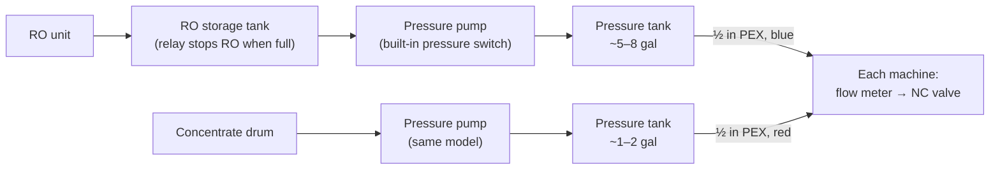

# Supply system — water and concentrate distribution

The auto-fill system in this repo only works because water and concentrate
already arrive at the machine **pressurised, on demand**. We built that
distribution system well before this project. This page describes it, because
several safety decisions depend on how it behaves.

## Water

- **RO (reverse-osmosis) water** from a dedicated RO unit — the same kind of
  system you'd find under a sink, but larger and higher-flow.
- It fills a **storage tank**. When the tank is full, a relay shuts the RO unit
  off.
- Downstream of the storage tank, a **pressure pump** pressurises a small
  **pressure tank** (~5–8 gal), which feeds the shop.
- At our machine, fills run at about **4.2–4.4 L/min (~1.1 gal/min)**.

## Concentrate

- The **same model of pressure pump** draws neat concentrate straight from the
  drum and pressurises its own small pressure tank (~1–2 gal).
- Flow **surges** when a valve opens (the pressure tank dumping), so we meter
  concentrate by volume, never by time.
- **Keep the line primed.** Air in it made our clamp-on flow meter read 2.1×
  high.

## Pumps

- One 120 V pressure pump per fluid, SEAFLO 33-series. Each has a **built-in
  pressure switch**, left at its factory setting.
- The pumps feed the **whole shop**.
- We switch them with **smart plugs** (Shelly Plug US Gen4): on during staffed
  hours, or during an automated fill, with a 30-minute limit on any after-hours
  turn-on. The automations are in
  [`config/home-assistant/`](../config/home-assistant/automations.yaml).

## Distribution

- **½" PEX** runs: **red for concentrate, blue for water**.
- **A separate run of each fluid to each machine** from the pressure tanks — not
  a shared manifold.
- **Manual shut-off valves** throughout the system.
- **No filters or strainers, and no check valves or backflow preventers.**
- At the machine, each line goes through the auto-fill system's flow meter and
  then a normally-closed solenoid valve ([build-notes.md](build-notes.md#flow-sensors-and-the-measurement-nipple)).

## Why this matters to the fill system

- **The small pressure tanks are a safety layer.** With the pumps off outside
  staffed hours, a valve stuck open can deliver at most what's in the pressure
  tank — about 5–8 gal of water — rather than an endless supply. That bound is
  part of the [safety ladder](safety.md#the-safety-ladder).
- **But a pump being off isn't the same as the supply being shut off.** The
  pressure tank keeps its charge after the pump stops, so a stuck valve still
  gets that tank's contents. It's a bound, not an isolation.
- **Shared pumps.** A fill on any machine re-pressurises every machine's run, so
  a stuck valve anywhere can draw from the pump whenever anyone demands supply.
  That's why a stuck valve should lock the pump off, not just raise an alarm —
  designed, not built yet ([safety.md](safety.md#known-gaps-as-of-2026-10-23)).
- **No filtering.** Debris in the supply is one of the likelier ways a solenoid
  valve sticks open.
- **Supply flow sets fill timing.** The per-fill cap, the script timeout and the
  6-minute valve watchdog are all sized around our measured flow
  ([fill-logic.md](fill-logic.md#5-the-metered-fill)). Measure yours.

## Planned improvements

- **An automated, fail-closed valve downstream of each pressure tank**, so
  turning the supply off actually isolates it — closing the stored-pressure gap.
- Considering strainers and check valves / backflow protection.

If you're connecting an RO unit to your building's water supply, check what
your local plumbing code requires for backflow protection.
