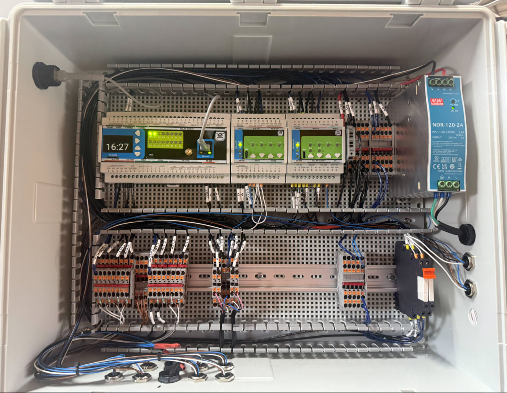
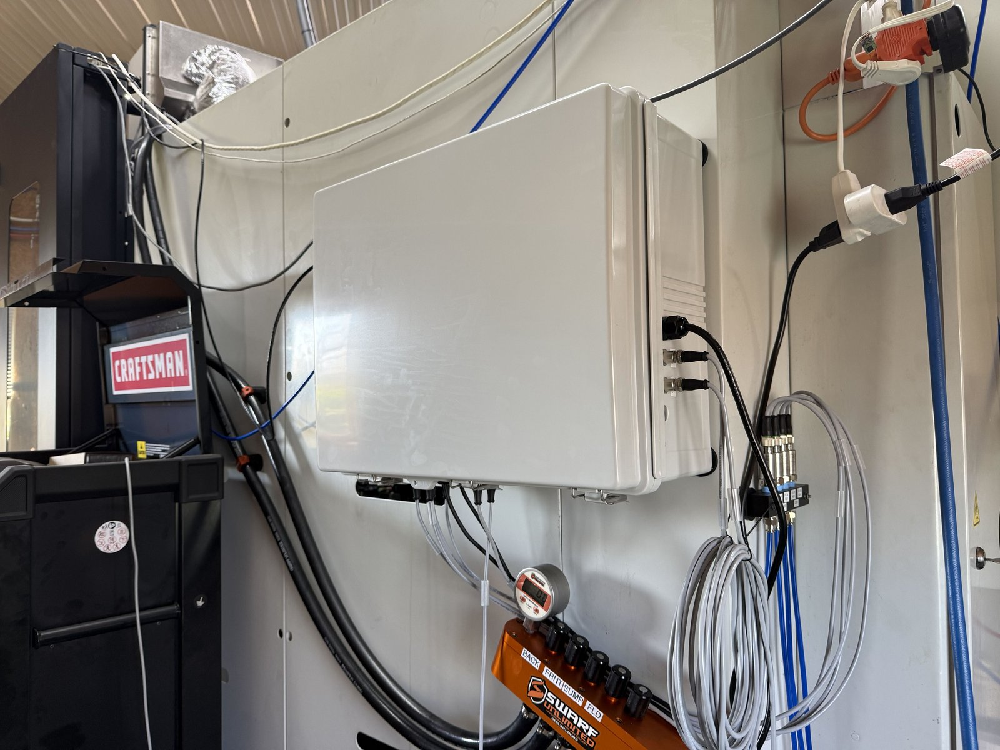
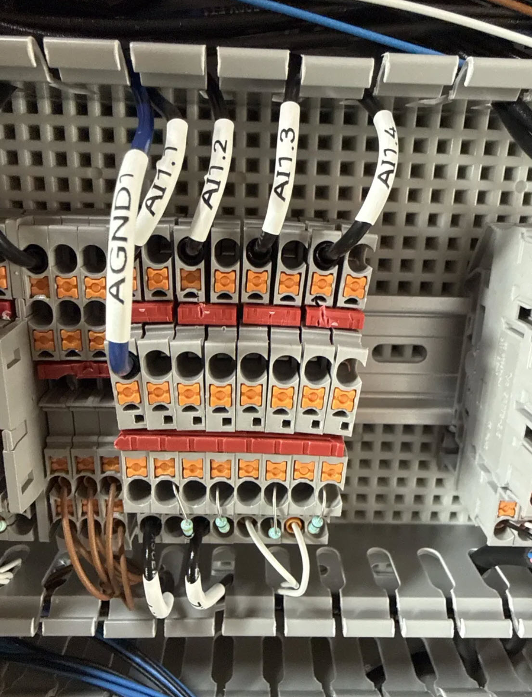
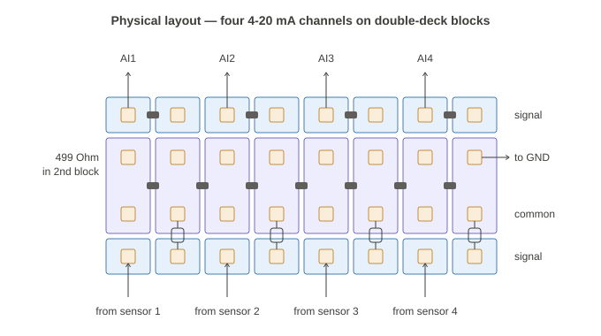
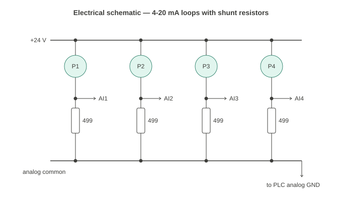
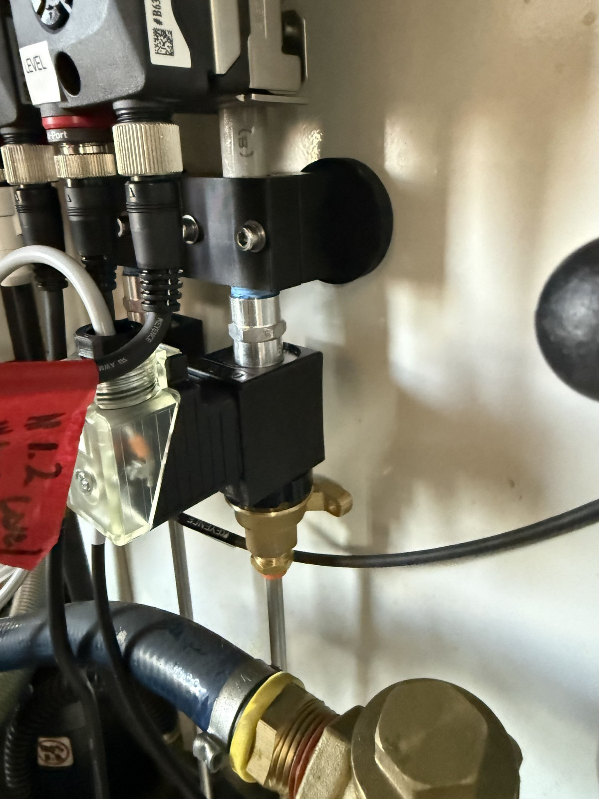
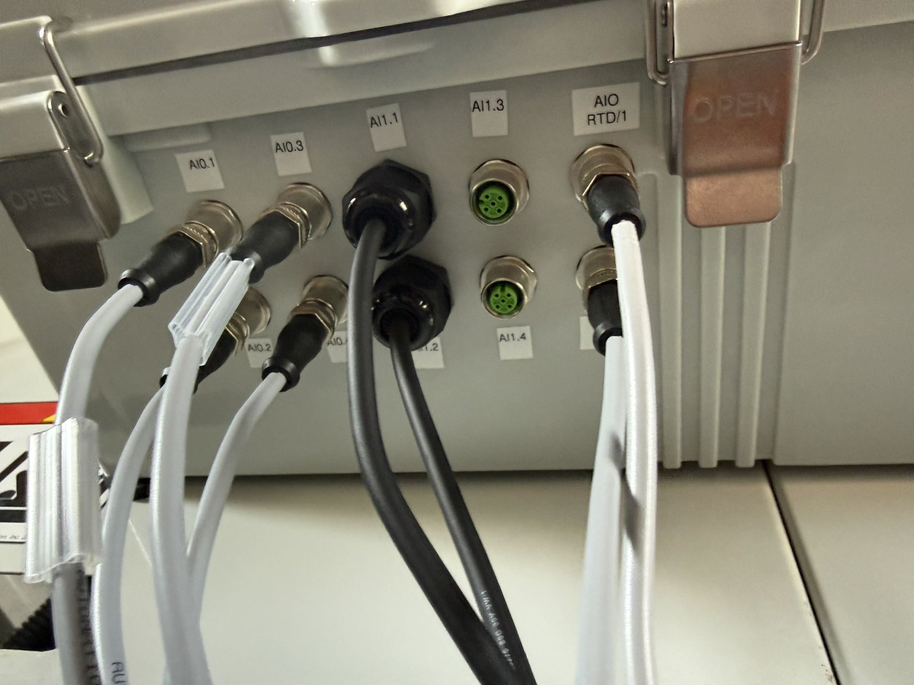
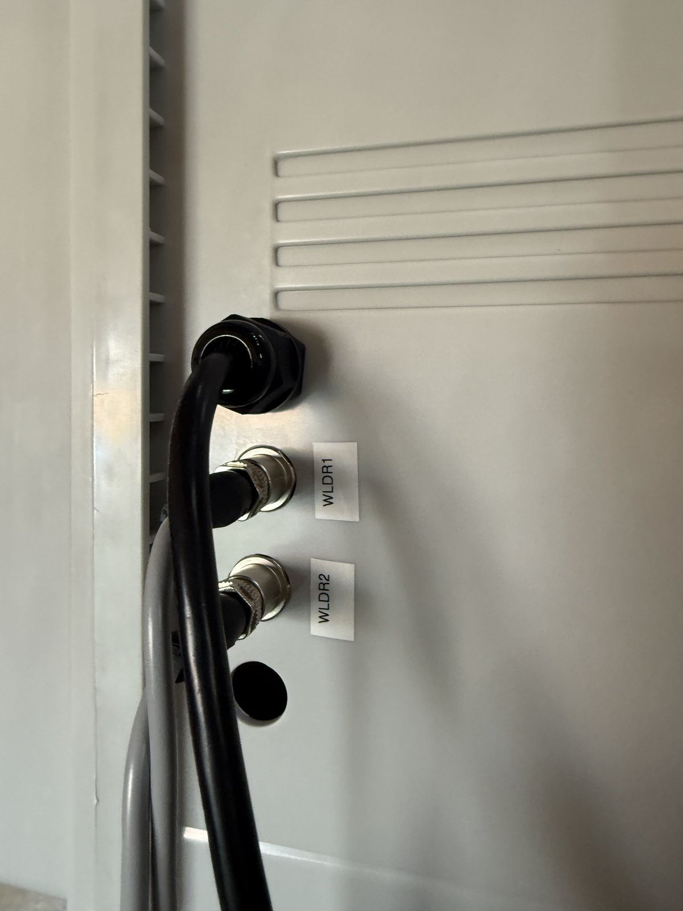

# Wiring

As built on our UMC-500 panel, confirmed terminal by terminal from photos on
2026-10-23. Where we'd do it differently next time, it says so.

*Top row, left to right: MiniPLC, AIO-422-R1, WLD-521-R1, terminal blocks, Mean
Well 24 V supply. Bottom row: MiniPLC shunt block, AIO shunt block, FD-H
distribution block, power distribution, the two interposing relays. M12
bulkheads along the bottom and right side.*

*Mounted on the machine. The pressure-transmitter manifold is to the right of
the enclosure.*

## Drawings

- **[coolant_panel_wiring.svg](../images/drawings/coolant_panel_wiring.svg)** —
  pin-level wiring of the whole panel (25 components, 66 connections; power
  shown as net labels).
- **[coolant_panel_wiring.drawio](../images/drawings/coolant_panel_wiring.drawio)**
  — the same, editable at [app.diagrams.net](https://app.diagrams.net).
- **[netlist.py](../images/drawings/netlist.py)** — the source. Both drawings
  are generated from one netlist; edit it and re-run to produce drawings for
  your own panel (needs Python and Graphviz).
- **Shunt-block layout and schematic** — in
  [Analog inputs and the shunt blocks](#analog-inputs-and-the-shunt-blocks)
  below.

Three things on the drawing are inferred rather than seen, and will be checked
on our second build: the MiniPLC's analog-common terminal label, which RTD lead
lands on RTD1 terminal 2 vs 3, and the pressure-transmitter order (taken from
our config comments).

## Power and fusing

**As built:** Mean Well **NDR-120-24** (24 V, 5 A, DIN rail) → **one WAGO
281-611 fuse terminal with a 4 A fuse** → the entire 24 V bus: MiniPLC, AIO,
WLD, both FD-Hs (with the radar and refractometer on their Multi-ports), four
pressure transmitters, relay commons and valve feeds.

**What's wrong with that:** one fault anywhere blows the one fuse and the whole
cabinet goes dark — monitoring, alerts and the valve watchdog included. (The
valves are normally closed, so they close; but nothing tells you why.)

**What we'll do on the next build:** put **each solenoid valve on its own
fuse** (the interposing relays' contact feeds), so a valve or valve-cable fault
drops only that valve. Probably also separate the field sensors (FD-Hs,
transmitters) from the controller modules. Size each branch fuse from the valve
coil's datasheet current — look it up, don't assume.

**Load sanity check for the 4 A main fuse:** each FD-H draws up to 830 mA with
Multi-port sensors attached (≈ 1.7 A for two), transmitters ≤ 20 mA each,
modules modest, plus two valve coils. Likely under 4 A, but the 4 A fuse and
5 A supply leave limited headroom with everything on at once. Confirm against
your valve coil current.

## Analog inputs and the shunt blocks

The MiniPLC's and AIO's analog inputs are **0–10 V, voltage only** — no
current-sense element, whatever the marketing says. Every 4–20 mA signal goes
across a **499 Ω, 1% shunt resistor** to that module's analog common, giving
about 2–10 V.

- **499 Ω**, not 250: we want the full range, and the FD-H tolerates up to
  500 Ω. No load margin left, and readings above 20 mA clip near 10 V — fine
  for our use (but it's why a blind radar's 21.5 mA reads as "full" rather
  than as a fault).
- **Wattage:** our panel has **¼ W** parts (Stackpole RNF14FTD499R), and at
  normal signal levels they're fine — our signals sit around 7–10 mA, which is
  0.02–0.05 W. At 20 mA a 499 Ω resistor dissipates 0.2 W (80% of a ¼ W
  rating), and a sensor stuck at a fault current (a blind radar outputs
  21.5 mA ≈ 0.23 W) runs it near its limit. Next time we'd use **½ W**
  (RNF12FTD499R) for margin; it costs pennies.
- **Calibrate end to end** with each sensor's simulation mode rather than
  trusting the resistor value. For our pressure transmitters we measured each
  channel's zero on a shared air manifold (see
  [build-notes.md](build-notes.md#commissioning-tests-we-ran)).

*The AIO shunt block: field wires AI1.1–AI1.4 in on top, the starred analog
common (AGND1) on the left, shunt resistors along the bottom.*

**The arrangement** (both shunt blocks are the same): a **pair of double-deck
terminal blocks per channel**. A signal node needs three connections —
field wire, wire to the module's analog input, and the resistor — one more than
a single deck has. So:

- The first block's **signal deck** takes the field wire (bottom) and the wire
  to the module's analog input (top).
- The second block's signal deck takes the resistor, which drops to the
  **common deck** below.
- The pair is joined by a **separate 2-position bridge on the signal deck**.
  🔴 A continuous bridge bar there would short all channels together.
- The **common deck is one continuous bridge** across all the blocks — the
  module's starred analog common (AGND / AGND1).

About 50 mm (2 in) of rail for four channels. We chose this over per-channel
signal isolators purely on panel space (an isolator is 22.5 mm each plus power
wiring). Isolators remain the better choice for long runs, noisy environments,
or field devices on a different ground.

**Analog commons are starred, not daisy-chained.** Every return lands on the
common node, with one conductor from there to the module's analog ground. The
real argument is serviceability: in a daisy chain, pulling one wire opens the
return for everything downstream. Each module with analog inputs gets its own
common node. **Make the analog common visually distinct** (colour or an AGND
label), or someone will eventually land a relay return on it.

**What each state looks like on an analog channel** (useful for diagnosis
without a meter):

| Reading | Means |
|---|---|
| ~0.01 V | Shunt fitted, nothing connected (or loop open) |
| ~2.0 V | Working transmitter at its 4 mA zero |
| Above the 0–10 V span | Not a 4–20 mA signal at all — something else is driving the input |

## FD-H distribution block

Both FD-H cables (Keyence FD-HCB2: M12 8-pin → bare wires, 2 m) land on the
bottom of a small terminal group and fan out on top:

| FD-HCB2 wire | FD-H #1 — concentrate + refractometer | FD-H #2 — water + radar |
|---|---|---|
| Brown (+24 V) | 24 V bus | 24 V bus |
| Blue (0 V) | **Bridged 0 V terminal** → WLD GND_ISO and supply 0 V | same terminal |
| Black (Ch1, pulse, NPN) | WLD I1 | WLD I2 |
| White (Ch2, 4–20 mA) | AI1.1 → shunt → AIO AI1 (Brix) | AI1.2 → shunt → AIO AI2 (level) |
| Grey (Ch3, error/health) | WLD I3 | WLD I4 |
| Pink (Ch4) | Parked on its own terminal, unconnected | Parked, unconnected |

Insulate unused FD-H wires individually — don't twist them together.

**Next build:** today the FD-H cables come in through cord grips, leaving the
excess 2 m of cable hanging off the enclosure. We'd rather use an **M12 8-pin
bulkhead** on the enclosure and an M12-to-M12 cable, so the sensor unplugs for
service. (Open question for Keyence: whether they offer that cable, or the
connector coding and pinout so a generic one can be used.)

## WLD inputs: they need voltage applied

This cost us two days, so it gets its own section. The WLD-521-R1's README and
wiring diagram show a dry contact wired from an input to **GND_ISO**. **That
never switches the input.** On our modules (both of them, so not a fault):

- An input reads **on** with **no voltage applied** (open, floating, or
  shorted to GND_ISO).
- It reads **off** with **~3.5–5 V applied** (referenced to GND_ISO).

So:
- **The float** is wired from the WLD's own **isolated 5 Vdc terminal**
  (bottom right) through the float contact to I5. Float down (contact closed,
  5 V applied) = **off = clear**. Float lifted (open, 0 V) = **on = high level**.
  And a cut cable, unplugged connector or lost 5 V rail also read **on** —
  fail-safe.
- **The FD-H outputs** (NPN, open collector) work because the FD-H itself pulls
  its output line up to ~3.6 V when the output is off.
- **The FD-H health outputs are therefore not fail-safe as configured** (N.C.):
  healthy = conducting = 0 V = on — but a cut wire is also 0 V = on. Planned
  fix: N.O. See [fill-logic.md](fill-logic.md#36-sensor-health-inputs--and-the-fail-safe-gap-we-found).

The full story is in [lessons.md](lessons.md#the-wld-521-inputs-need-voltage-applied).

## Grounding: the deliberate GND_ISO bridge

The WLD has one isolated ground (GND_ISO) for all five inputs. The FD-H pulse
outputs are NPN, so their 0 V has to share the WLD input's reference. We tie
**FD-H 0 V, WLD GND_ISO and the supply 0 V together on one bridged terminal**.
That bypasses the WLD's input isolation for the whole input group.

**This is deliberate — don't "fix" it.** We accepted it because the cabinet 0 V
is **not** bonded to earth, and the high-level sensor is a float (a sealed dry
contact), not a conductive probe touching coolant. If you put anything on those
inputs that touches the coolant electrically, revisit this.

## Valve outputs and interposing relays

The WLD's relays don't drive the valves directly; each drives an **interposing
relay** (Klemsan KPR-SCS-24VAC/DC, 6 A contacts):

- **WLD relay:** C ← 24 V bus; NO → interposer coil **A1**; coil **A2** → DC
  common (never the analog common). WLD relay 1 → interposer "WLDR1"
  (concentrate); relay 2 → "WLDR2" (water).
- **Interposer contact:** 11 ← 24 V bus; 14 → valve + (via the M12 bulkhead);
  valve return → 0 V bus.
- The interposer has an AC/DC coil (internal rectifier), so A1/A2 aren't
  polarity-sensitive.
- **Coil suppression is in the valve plug:** Murrelektronik **SC18-LS24-0**
  DIN 43650 Form A plugs with built-in bidirectional surge suppression and an
  LED. No loose diodes, no polarity to get wrong. ⚠️ The plug is marked *not
  for interrupting current* — switch the relay off before unplugging a valve.

**Valves:** 2-way **normally closed** 24 VDC solenoid valves, ¼" FNPT, one per
line, mounted **downstream of the flow meter** (keeps the meter's pipe full
and pressurised between fills, and lets the meter see flow through a stuck
valve).

*The water valve, right below its flow meter. The clear DIN plug has the
suppression and LED built in.*

## Valve-port M12 standard

The valve cables plug into M12 bulkheads on the cabinet. Ours are wired
**off the usual convention** — copy it exactly rather than mixing:

| M12 pin | Colour | Use |
|---|---|---|
| 2 | white | **switched +24 V** (from the interposer's NO contact) |
| 3 | blue | **0 V** |
| 1, 4 | brown, black | unused (cut short and capped inside the panel) |

At the valve plug: white → terminal 1, blue → terminal 2, earth terminal
empty. **Label valve ports clearly** — they use the same connector as the
sensor ports but carry switched 24 V.

Fitting the cordset into the valve plug: the plug's gland seals on 6.1–8.1 mm
cable and the cordset is ~5.2 mm, so build it up with one layer of ½"
adhesive-lined heat shrink under the gland. The plug terminals are rated
16–12 AWG against 22 AWG conductors, so fold each conductor back and crimp it
in a 20 AWG ferrule.

## RS-485

MiniPLC ↔ AIO (address 3) ↔ WLD (address 4), 19,200 baud, daisy-chained B/A/COM.
Our runs are a few inches inside one cabinet. For longer or permanent runs our
standard is **Belden 9841** (1 pair, 24 AWG, shielded, 120 Ω).

## Panel conventions

- **Hookup wire:** MTW / UL1015 stranded, 18–22 AWG for signal runs.
- **Colours:** black for DC/control, blue for DC common, green or green/yellow
  only for AC earth.
- **Labels** on every termination (printed heat-shrink).
- **Field connections at M12 bulkheads** on the enclosure wall rather than
  cables through glands — the cabinet stays sealed and sensors unplug for
  service. Our standard going forward is a 1 m pigtail on the bulkhead (reaches
  further inside the panel than 0.5 m, for about $1 more). Bulkhead faces are
  **female** (sensors have male M12s).
- **Keep spare conductors** on analog ports landed rather than clipped, so any
  port can later take a 3-wire sensor.
- **Jumper bars are series-specific.** The number in a terminal block or bridge
  name (the "2.5" in ST2-2.5) is the conductor size in mm², not a fit. Buy
  bridges against the block's own family, and order them together. (We bought
  jumpers that didn't fit our blocks.)
- **Bulkheads on our panel:** 8 on the bottom face (4 pressure transmitters, 2
  spare analog, RTD, float), 2 on the side (valves), 3 cord grips (2 FD-H
  cables, mains in), an RJ45 bulkhead for Ethernet, and one spare hole.

*Bottom face: pressure transmitters (AI0.x), the two FD-H cables through cord
grips (AI1.1, AI1.2), capped spares (AI1.3, AI1.4) and the RTD.*

*Side face: mains in, and the two valve ports (WLDR1 concentrate, WLDR2 water).*
